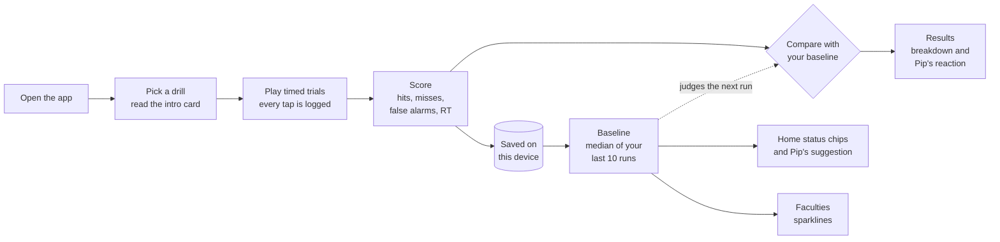
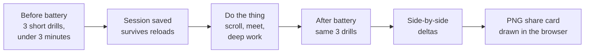
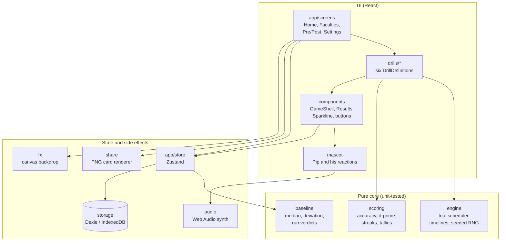
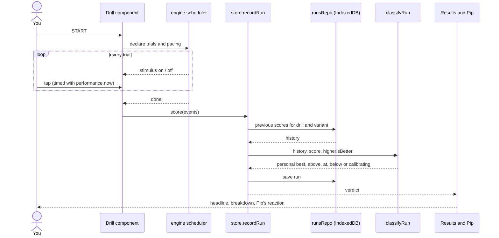

<div align="center">

# Cortex Deck

**A local-first focus-recovery console.** Six short cognitive drills, honest scoring, and a baseline built only from your own history.

[](https://github.com/Arley100/cortex-deck/actions/workflows/ci.yml)
&nbsp;·&nbsp; **[cortexdeck.vercel.app](https://cortexdeck.vercel.app)** &nbsp;·&nbsp; no accounts · no network calls · no analytics


&nbsp;&nbsp;


</div>

---

You arrive with a feed-fried brain (LinkedIn, reels, Discord) and can't lock onto a task. Cortex Deck gives you six drills of one to two minutes each, scores them without flattery, and keeps a rolling baseline per drill. The home screen shows which drills are below **your own** baseline today and suggests a few targeted reps there.

Everything runs in the browser. Runs are stored in IndexedDB on your device and never leave it unless you export them yourself.

## Contents

1. [How it works](#how-it-works)
2. [How to play](#how-to-play)
3. [Your baseline](#your-baseline)
4. [Meet Pip](#meet-pip)
5. [Pre/Post mode](#prepost-mode)
6. [Sound](#sound)
7. [Design decisions](#design-decisions)
8. [Architecture](#architecture)
9. [Quality](#quality)
10. [What this is not](#what-this-is-not)
11. [Development](#development)
12. [Data and privacy](#data-and-privacy)

## How it works



- **Every run is saved** with its headline score and full breakdown, tagged by drill and variant (2-back and 3-back are tracked separately).
- **Your baseline** is the median of your last 10 runs of that drill. It appears after 3 runs.
- **Each new run is compared with the baseline from the runs before it**, so a run never counts toward the baseline it is judged against.
- **The home screen** turns those comparisons into status chips and a suggestion: if a drill is below your baseline today, Pip says so and suggests a few reps there.

## How to play

Every drill opens on an intro card with its rules and parameters. Tap **START** (or **2-BACK** / **3-BACK** for N-Back) when you are ready. **EXIT** leaves at any time; an unfinished run is not saved.

| Drill | Trains | What you see | What you do | Ends when |
| --- | --- | --- | --- | --- |
| **N-Back** | working memory | One cell of a 3×3 grid lights up every 2.4 s. | Tap **MATCH** when the lit cell is the same as the one *N* steps back (2 or 3). Do nothing otherwise. | 24 trials are done. |
| **Stroop** | attention, inhibition | A color word (RED, GREEN, BLUE, AMBER) printed in a different ink. | Tap the button for the **ink** color, not the word. | 45 seconds are up. |
| **Sequence** | memory span | Four pads flash a pattern, one longer each round. | Watch, then repeat the pattern in order. | You make one wrong tap. |
| **Math Sprint** | processing speed | A sum, difference or product with four answer tiles. | Tap the right answer as fast as you can; chain correct answers into a streak. | 60 seconds are up. |
| **Reaction** | response time | A dark panel that turns green after a random 1.4 to 4 s wait. | Tap the moment it turns green. Tapping early is flagged and that trial restarts. | 5 valid taps are recorded. |
| **Go / No-Go** | response inhibition | A green circle (68% of trials) or a red square (32%). | Tap fast on green. Hold still on red. | 28 trials are done. |

### How each drill is scored

Every drill reports the parts of its score separately. Nothing is folded into one flattering number.

| Drill | Headline | Also reported |
| --- | --- | --- |
| N-Back | accuracy % and d′ | hits, missed matches, false alarms, correct passes |
| Stroop | correct answers | accuracy, wrong answers, answers per minute |
| Sequence | longest chain repeated correctly | span |
| Math Sprint | correct answers | accuracy, wrong answers, best streak |
| Reaction | fastest tap in ms (lower is better) | average, early taps |
| Go / No-Go | accuracy % and d′ | hits, correct stops, taps on red, missed greens, mean go speed |

**d′ (d-prime)** measures how well you tell targets from non-targets, independent of how trigger-happy you are. When a hit or false-alarm rate is exactly 0 or 1, the standard 1/(2N) correction is applied, so a perfect run reports a finite number instead of infinity.

<p align="center">
  
  
  
  
</p>

## Your baseline

| Status chip | Meaning | Rule |
| --- | --- | --- |
| `calibrating: N/3` | Not enough history yet. | Fewer than 3 runs of this drill and variant. |
| `no run today` | A baseline exists but you have not played this drill today. | No run since local midnight. |
| `at baseline` | Today's run is in your normal range. | Within ±10% of your baseline. |
| `above baseline` | Today's run is better than usual. | More than 10% better. |
| `below baseline` | Today's run is lower than usual. | More than 10% worse. |

For Reaction, lower is better, so the comparison is inverted: a faster time counts as *above*.

The **Faculties** screen lists all six drills with your baseline, today's value and a sparkline of your last 10 runs. The dashed line is your baseline, and up always means better.

<p align="center">
  
</p>

## Meet Pip

<p align="center">
  
</p>

Pip is the console's companion. He greets you on the home screen, suggests where to spend your reps, and reacts once each run finishes.

| Your run | Pip | What he says |
| --- | --- | --- |
| Better than every previous run | Claps four times, hops, sparkles | "New personal best. Your previous best was 71%." |
| More than 10% above baseline | Claps three times | "Above your baseline of 66%." |
| Within 10% of baseline | Nods, thumbs up | "Right at your baseline of 66%. Steady." |
| More than 10% below baseline | Raises both fists | "Below your baseline of 6.5 today. Another rep?" |
| Fewer than 3 runs logged | Waves | "Calibrating: 2/3 runs logged." |

He never praises more than the numbers justify. "Below" describes the run, never the person, and a unit test checks every line he can say against the project's banned-wording list.

<p align="center">
  
  
</p>

## Pre/Post mode

Measure how something you do affects your focus, for example 30 minutes of scrolling, a meeting or a deep-work block.



The default battery is Stroop (30 s), Reaction (3 trials) and Go/No-Go (20 trials); you can pick any 3 drills in Settings. The result is a plain side by side, for example "Stroop: 31 → 24 correct, −23%", plus a 1200×630 share card. On phones it opens the share sheet; elsewhere it downloads.

<p align="center">
  
  &nbsp;
  
</p>

## Sound

All audio is generated in the browser with the Web Audio API: no audio files and no downloads. Both switches are in the top bar and in Settings.

| Channel | Default | What you hear | When it plays |
| --- | --- | --- | --- |
| **SFX** | on | Soft ticks and two-note tones; Pip's claps | Only after your own taps and when results appear |
| **Drone** | off | A low hum with a 6 Hz left-right offset (best on headphones) and slow swells about every 11 seconds | Continuously while switched on |

## Design decisions

Some choices look odd until you know why they were made.

| Question | Answer |
| --- | --- |
| Why does the background go quiet during a drill? | On drill screens the moving constellation dims, slows down and stops reacting to the pointer, so nothing on screen competes with the stimulus you are responding to. |
| Why is there no sound when the Reaction panel turns green? | A sound at the moment of the stimulus would turn a visual reaction test into an audio one and make times faster. Sounds only acknowledge your taps, so runs with sound on stay comparable with silent ones. |
| Why does the Reaction waiting screen not animate? | Any pulse or rhythm on screen could become a timing cue and encourage early taps. |
| Why didn't Pip clap after my run? | He claps only when the run beats your baseline or your best. Matching your baseline earns a nod; a lower run earns encouragement. |
| Why are my first runs "calibrating"? | A baseline from one or two runs is mostly noise. Three runs is the minimum before comparisons start. |
| Does "below baseline" mean something is wrong? | No. It only means this run scored lower than your recent median. Sleep, time of day and attention vary; the trend across many runs says more than any single day. |
| Why is there no overall score? | Hits, misses and false alarms describe different things. Combining them would hide exactly what you need to see. |
| Why does the Reaction sparkline go up when I got faster? | Every sparkline is drawn so that up means better. For Reaction, better means fewer milliseconds. |
| Do Pre/Post batteries change my baseline? | No. Battery runs are shorter and are stored separately, so they never mix into your full-length baselines. |
| Why does Pip look the way he does? | His shaved, monk-like head and traditional haori and hakama stand for calm, steady practice. The round, soft face and headphones make him friendly and connect him to the focus drone. The tie on his chest glows in the color of his mood. |
| Can I turn the motion off? | Yes. With your system's reduced-motion setting on, the backdrop is a single still frame and every animation settles immediately. |

| Visual element | Purpose |
| --- | --- |
| Deep-navy glass panels | Quiet surfaces that let colored feedback stand out |
| Constellation backdrop that reaches for the pointer | Gives the home screen life without touching the drills |
| Glass shards that trail the mouse and burst on click | Playful feedback on non-drill screens only |
| RGB-split glitch titles | Gives the console its identity on titles and result headlines |
| Clipped-corner buttons and viewfinder brackets | Large, clearly bounded touch targets with a console feel |
| One accent color per drill | Lets you recognize each drill at a glance |

<p align="center">
  
</p>

## Architecture



### Lifecycle of one run



| Module | Responsibility | Notes |
| --- | --- | --- |
| `app/` | Shell, state-based routing, Zustand store, screens | The store records runs and computes each run's verdict |
| `drills/` | One folder per drill, each exporting a `DrillDefinition` | Drills declare trials; they never own raw timers |
| `engine/` | Trial scheduler, tracked timelines, seedable RNG | Every timer is cancelled on unmount |
| `scoring/` | Accuracy, d-prime, streaks, tallies | Pure and fully unit-tested |
| `baseline/` | Rolling median, deviation flags, run verdicts | Pure and fully unit-tested |
| `storage/` | Dexie schema with a migration scaffold, runs and settings repos, export/import | All data stays on the device |
| `mascot/` | Pip's SVG, mood animations and verdict-to-reaction mapping | His wording is checked by tests |
| `audio/` | Synthesized sound effects and the ambient drone | No audio files |
| `fx/` | Constellation and shard canvas | Calm mode on drill screens |
| `share/` | Pre/Post share-card renderer | Canvas, fully client-side |
| `components/` | Shared UI: GameShell, Results, buttons, StatusChip, Sparkline | Reused by every screen |

Every drill implements one contract:

```ts
interface DrillDefinition {
  id: DrillId;
  name: string;
  faculty: string;
  variants?: string[];
  run(ctx: DrillContext): void;
  score(events: TrialEvent[]): DrillScore;
}
```

## Quality

| Check | Result |
| --- | --- |
| Unit and component tests (Vitest, React Testing Library) | 105 tests across 17 files |
| Type checking | TypeScript strict mode, no errors |
| Lint | ESLint, no warnings |
| Lighthouse, mobile, production build | Performance 97 · Accessibility 100 · Best Practices 100 |
| CI | Typecheck, lint, tests and build on every push and pull request |

Every control is reachable by keyboard, and the layout is designed for a 380 px phone first, with desktop as the secondary case.

## What this is not

- **Not a medical device.** It does not detect, assess or treat any condition.
- **Not an intelligence test or booster.** It measures task performance relative to your own history, nothing more.
- **Limited transfer.** Training these drills makes you better at these drills. Transfer to other skills is limited; that is what the research on practiced-task training generally shows.

## Development

```bash
npm install
npm run dev        # Vite dev server on :5173
npm run test       # Vitest, single run
npm run typecheck  # tsc --noEmit (strict)
npm run lint       # ESLint
npm run build      # typecheck and production build
```

**Stack:** Vite · React 18 · TypeScript (strict) · Tailwind CSS 4 · Zustand · Dexie (IndexedDB) · Vitest and React Testing Library. Fonts are self-hosted and bundled with the app. The site deploys to Vercel as a static build.

## Data and privacy

All data lives in your browser's IndexedDB. Settings has a one-file JSON export and import, and a wipe-all-data action with a confirm step. Nothing leaves your device unless you move the export file yourself.

## Repository

[github.com/Arley100/cortex-deck](https://github.com/Arley100/cortex-deck)
