<div align="center">

# Cortex Deck

**A local-first focus-recovery console.** Six short cognitive drills, honest scoring, and a baseline built only from your own history.

[](https://github.com/Arley100/cortex-deck/actions/workflows/ci.yml)
&nbsp;·&nbsp; **[cortexdeck.vercel.app](https://cortexdeck.vercel.app)** &nbsp;·&nbsp; no accounts · no network calls · no analytics

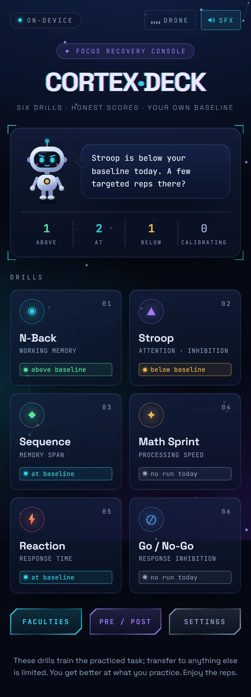
&nbsp;&nbsp;
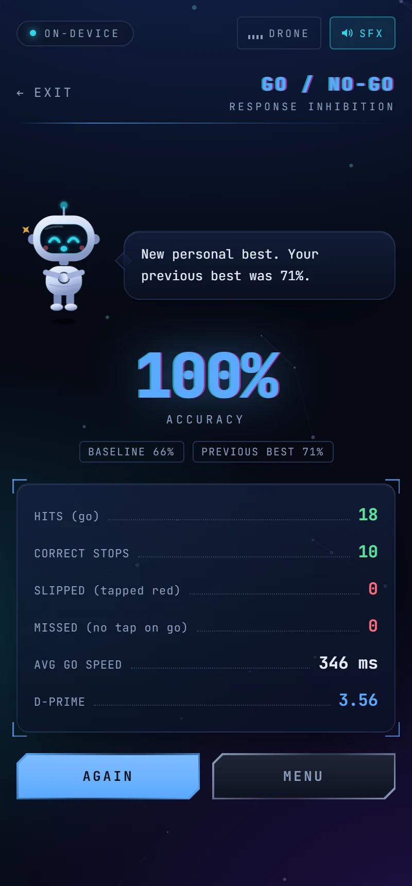

</div>

---

You arrive with a feed-fried brain (LinkedIn, reels, Discord) and can't lock onto a task. Cortex Deck gives you six two-minute drills, scores them without flattery, and tracks a rolling baseline per drill. The home screen shows which drills are below **your own** baseline today and suggests a few targeted reps there.

Everything runs in the browser. Runs are stored in IndexedDB on your device and never leave it unless you export them yourself.

## Contents

- [The drills](#the-drills)
- [Meet Pip](#meet-pip)
- [Baselines and honest scoring](#baselines-and-honest-scoring)
- [Pre/Post mode](#prepost-mode)
- [Sound](#sound)
- [Design](#design)
- [What this is not](#what-this-is-not)
- [Architecture](#architecture)
- [Development](#development)
- [Data and privacy](#data-and-privacy)

## The drills

| Drill | Faculty | Parameters | Headline metric | Always reported separately |
| --- | --- | --- | --- | --- |
| **N-Back** (2-back / 3-back) | working memory | 3×3 grid, 24 trials, 2.4 s pace, 32% forced matches | accuracy % + d′ | hits, missed matches, false alarms, correct passes |
| **Stroop** | attention, inhibition | 45 s, 4 inks, 75% incongruent | correct answers | accuracy, wrong, answers per minute |
| **Sequence** | memory span | 4 pads, +1 step per round, one miss ends it | longest chain | span |
| **Math Sprint** | processing speed | 60 s, + − ×, 4 choices within ±6 | correct answers | accuracy, wrong, best streak |
| **Reaction** | response time | 5 trials, random 1.4–4 s delay | fastest ms (lower is better) | average, early taps |
| **Go / No-Go** | response inhibition | 28 trials, 68% go, 850 ms window | accuracy % + d′ | hits, correct stops, commissions, omissions, mean go RT |

d′ uses the standard 1/(2N) correction when a hit or false-alarm rate is 0 or 1, so a perfect run reports a finite number instead of infinity.

<p align="center">
  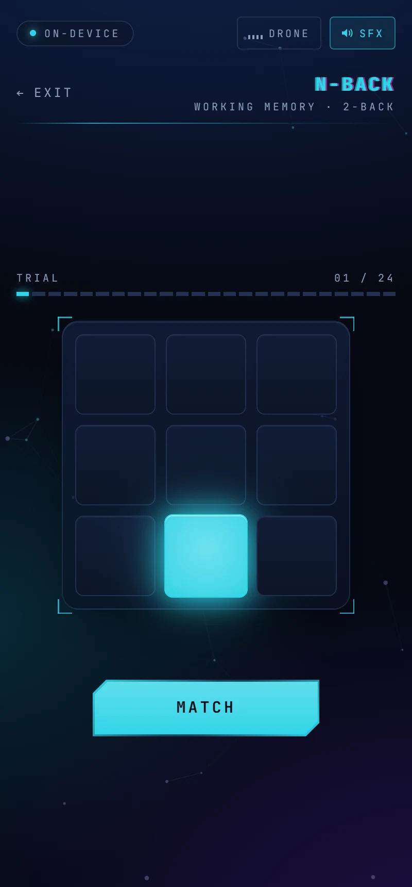
  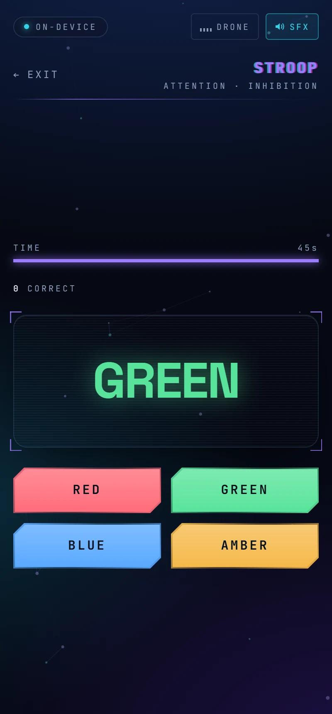
  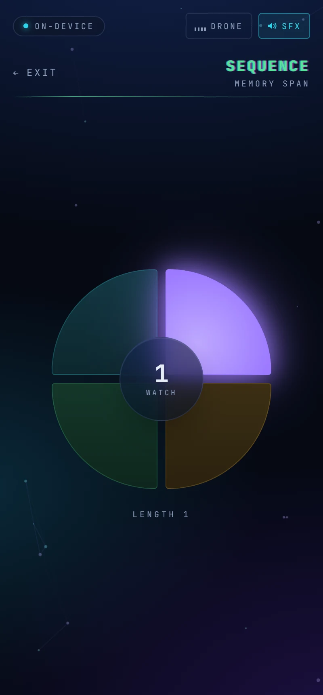
  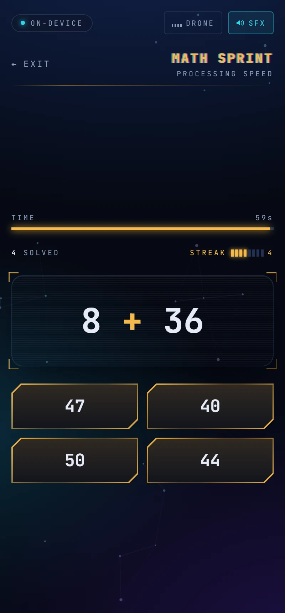
</p>

## Meet Pip

<p align="center">
  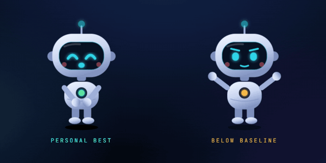
</p>

Pip is an original character who reacts to every finished run. He is half Japanese ichimatsu doll (shaved, monk-like scalp, porcelain face, haori jacket over striped hakama, tabi feet) and half plush desk companion (round soft head, dot eyes, blush, and headphones that nod to the app's ambient drone). The tie on his chest glows in the color of his mood, and his eyes follow your pointer. He is pure SVG and CSS: no image files, crisp at any size.

His reaction comes from one pure function, `classifyRun` in [`src/baseline/verdict.ts`](src/baseline/verdict.ts), which compares the run with the baseline computed from your **previous** runs. A run never counts toward the baseline it is judged against.

| Your run | Pip | What he says |
| --- | --- | --- |
| strictly better than every previous run | claps 4×, hops, sparkles | "New personal best. Your previous best was 71%." |
| more than 10% better than baseline | claps 3× | "Above your baseline of 66%." |
| within ±10% of baseline | nods, thumbs up | "Right at your baseline of 66%. Steady." |
| more than 10% worse than baseline | pumps both fists | "Below your baseline of 6.5 today. Another rep?" |
| fewer than 3 runs logged | waves | "Calibrating: 2/3 runs logged." |

He never praises more than the numbers justify, and "below" is described as a state of the run, never a judgment of you. A unit test checks every line he can say against the project's banned-wording list.

<p align="center">
  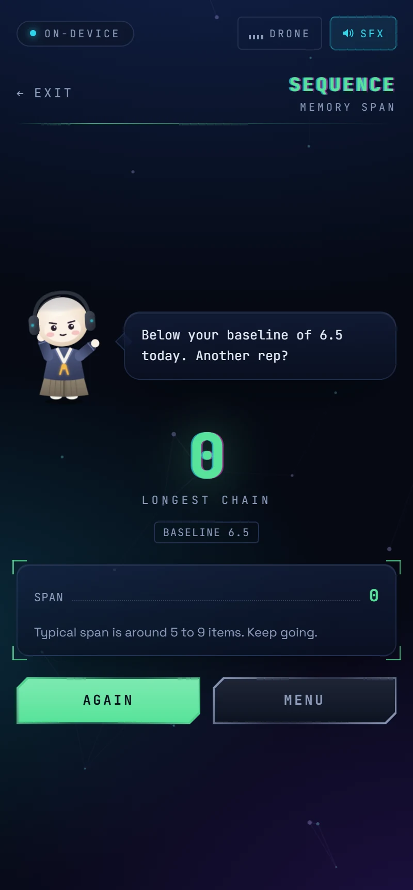
  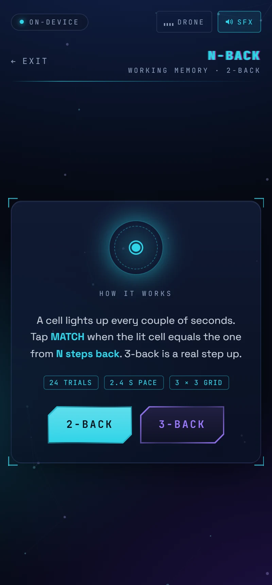
</p>

## Baselines and honest scoring

- Every completed run is stored: `{ drillId, variant, timestamp, score, breakdown, sessionTag }`.
- **Baseline** per drill and variant = rolling median of the last 10 runs. It exists from 3 runs; before that the UI shows `calibrating: N/3`.
- **Deviation** of today's run: within ±10% is *at*, more than 10% better is *above*, more than 10% worse is *below*. For Reaction (lower is better) the comparison inverts.
- **Faculties** lists every drill with baseline, today's value and an inline-SVG sparkline of the last 10 runs. The dashed line is the baseline; up always means better, so Reaction's chart is flipped.

<p align="center">
  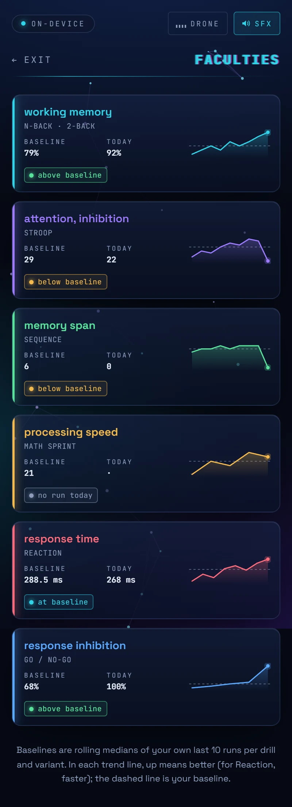
</p>

## Pre/Post mode

Run a short battery (default: Stroop 30 s, Reaction 3 trials, Go/No-Go 20 trials; under 3 minutes), go do whatever you were going to do, then run the same battery again. Both halves share a `sessionTag`, survive reloads, and are stored under a separate `battery` variant so they never mix into full-length baselines.

The result is a neutral side by side ("Stroop: 31 → 24 correct, −23%") plus a **1200×630 PNG share card** drawn on a canvas entirely in the browser. On phones it opens the native share sheet; elsewhere it downloads.

<p align="center">
  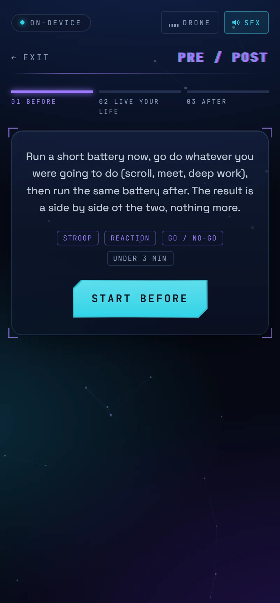
  &nbsp;
  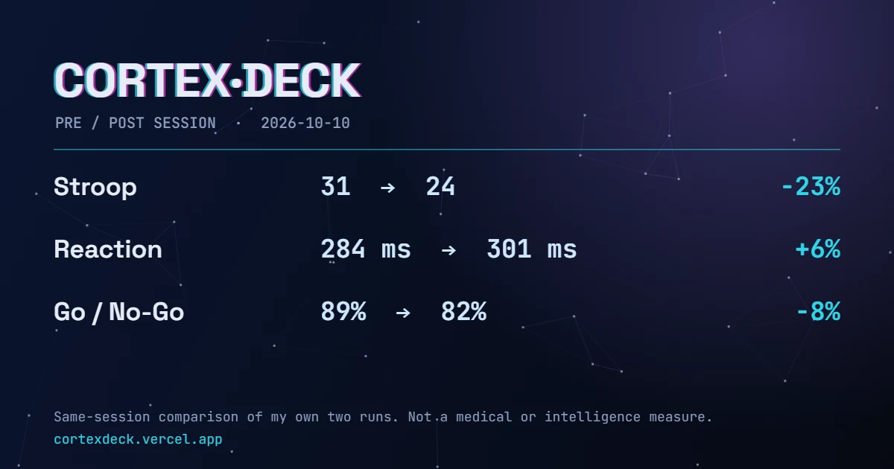
</p>

## Sound

All audio is synthesized at runtime with the Web Audio API: no audio files, no requests. Two switches live in the top bar and in Settings.

- **SFX** (on by default): soft ticks and two-note tones acknowledging your taps, plus Pip's claps, synced to his animation.
- **Drone** (off by default): a low pad with a 110 Hz / 116 Hz left-right pair (a 6 Hz binaural offset, best on headphones) and a pink-noise bed that swells about every 11 seconds, a pace you can breathe along with.

Measurement rule: **a sound never announces a stimulus.** There is no tone when the Reaction panel turns green, during Sequence playback, or at N-Back onsets. Sounds only follow your own input, so scores stay comparable with silent runs and with history recorded before sound existed. The drone is offered as a backdrop some people find settling; the app makes no claim that it changes scores.

## Design

The visual language combines interaction patterns explored on [21st.dev](https://21st.dev) with two character references for the mascot, all rebuilt from scratch for this app:

| Element | Where it shows up |
| --- | --- |
| Deep-navy glass with drifting crystal shards that trail the mouse and burst on click | backdrop and every panel |
| A constellation whose lines reach for your pointer | full-screen canvas field |
| Chromatic RGB-split text with brief slice glitches | wordmark, screen titles, results headline |
| HUD buttons with clipped corners and viewfinder brackets | every button, card and panel |
| Eyes that track the cursor | Pip |
| Ichimatsu doll styling crossed with a plush, headphone-wearing desk companion | Pip |

Two rules keep the decoration out of the measurement:

1. **Calm during drills.** On drill and battery screens the field dims to 40%, slows down, and turns pointer effects off, so nothing moving competes with a stimulus. The Reaction wait screen is deliberately static, because a pulsing animation could act as a timing cue.
2. **Mechanics are untouched.** Trial timing, scoring and input handling are unchanged (Reaction still measures on `click`), so existing baselines stay valid.

Fonts (Space Grotesk, JetBrains Mono) are self-hosted through Fontsource and bundled with the app; there are no third-party font requests. `prefers-reduced-motion` freezes the field to a single static frame and settles every animation immediately.

<p align="center">
  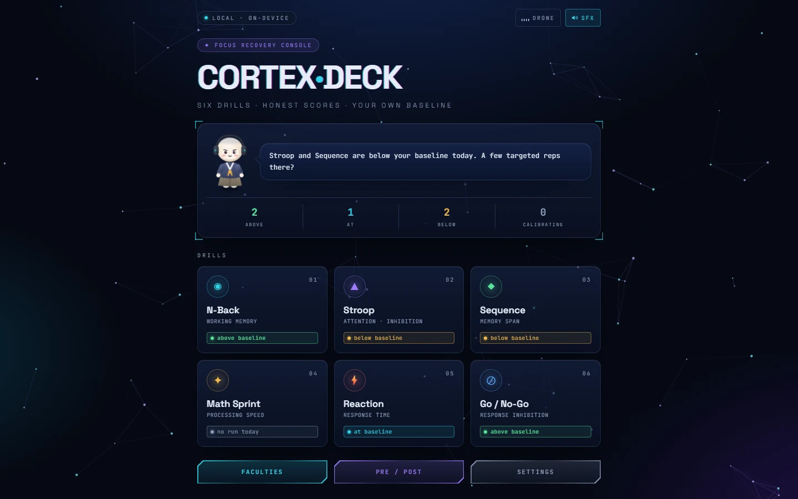
</p>

## What this is not

- **Not a medical device.** It does not detect, assess or treat any condition.
- **Not an intelligence test or booster.** It measures task performance relative to your own history, nothing more.
- **Limited transfer.** Training these drills makes you better at these drills. Transfer to other skills is limited; that is what the research on practiced-task training generally shows.

## Architecture

```
src/
  app/          shell, state-based routing, Zustand store, screens
  drills/       one folder per drill, each exporting a DrillDefinition
  engine/       shared trial scheduler, tracked timelines, seedable RNG
  scoring/      pure: accuracy, d-prime, streaks, tallies (fully unit-tested)
  baseline/     pure: rolling baseline, deviation flags, run verdicts
  storage/      Dexie schema with migration scaffold, runs and settings repos, export/import
  audio/        Web Audio engine: synthesized SFX and the ambient drone
  mascot/       Pip (SVG + CSS moods) and the pure verdict-to-reaction mapping
  fx/           constellation and crystal-shard canvas
  share/        pre/post share-card renderer
  components/   GameShell, Results, HUD Btn, StatusChip, Sparkline, GlitchText, ...
```

Every drill implements one contract and never owns raw `setTimeout` chains; timing lives in `engine/` and is cancelled on unmount.

```ts
interface DrillDefinition {
  id: DrillId;
  name: string;
  faculty: string;
  variants?: string[];
  run(ctx: DrillContext): void;
  score(events: TrialEvent[]): DrillScore;
}
```

## Development

```bash
npm install
npm run dev        # Vite dev server on :5173
npm run test       # Vitest, single run
npm run typecheck  # tsc --noEmit (strict)
npm run lint       # ESLint
npm run build      # typecheck + production build
```

CI on GitHub Actions runs typecheck, lint, tests and the build on every push and pull request. The site deploys to Vercel as a static build.

**Stack:** Vite · React 18 · TypeScript (strict) · Tailwind CSS 4 · Zustand · Dexie (IndexedDB) · Vitest + React Testing Library.

## Data and privacy

All data lives in your browser's IndexedDB. Settings has a one-file JSON export and import, and a wipe-all-data action with a confirm step. Nothing leaves your device unless you move the export file yourself.

## Repository

[github.com/Arley100/cortex-deck](https://github.com/Arley100/cortex-deck)
